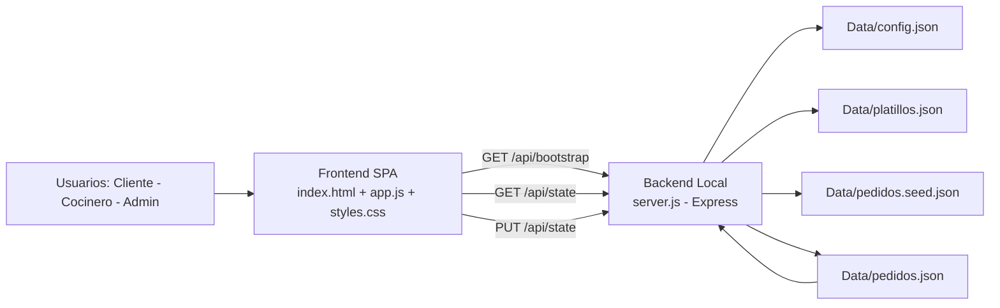
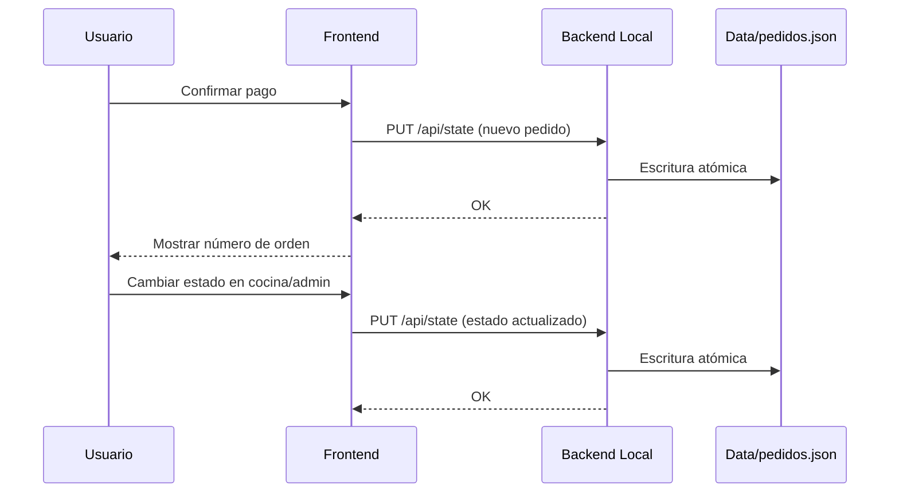

# Documentación Técnica - El Combo Mortal

## 1. Qué hace la solución y cómo se ejecuta (basado en historias de usuario)

### 1.1 Objetivo funcional
La solución El Combo Mortal centraliza el flujo operativo de pedidos de comida rápida en una app web portable y liviana.

Cobertura funcional alineada a historias de usuario:

1. Cliente:
- Visualiza menú con platillos disponibles y no disponibles.
- Agrega productos al carrito y confirma pago.
- Recibe número de orden único y consulta estado.

2. Cocinero:
- Consulta pedidos en orden de llegada.
- Revisa detalle por ítem.
- Cambia estados de preparación de ítems para avanzar la orden.

3. Administrador:
- Filtra pedidos por estado.
- Marca pedidos listos como entregados.
- Consulta reportes de ingresos por rango y por platillo.
- Exporta e importa respaldo operativo.

4. Operador técnico:
- Garantiza persistencia total en JSON local.
- Mantiene la continuidad operativa al reiniciar servidor o navegador.

### 1.2 Modelo de datos operativo
La solución usa JSON locales dentro de Data:

- config.json: parámetros globales (impuesto, locale, versión).
- platillos.json: catálogo editable de menú.
- pedidos.seed.json: semilla para inicialización de estado.
- pedidos.json: estado operativo real (secuencia, pedidos, carrito).

Regla principal:
- Toda acción de negocio (crear pedido, cambiar estado de cocina, entregar pedido, importar respaldo) termina persistida en Data/pedidos.json.

### 1.3 Ejecución local
Prerrequisitos:
- Node.js instalado.
- npm disponible.

Pasos:

1. Abrir terminal en la carpeta ComboMortalNuevo.
2. Instalar dependencias:

```bash
npm install
```

3. Iniciar servidor:

```bash
npm start
```

4. Abrir navegador en:

- http://localhost:3080

### 1.4 Flujo de arranque
1. El frontend solicita GET /api/bootstrap.
2. El backend carga config.json, platillos.json, pedidos.seed.json y pedidos.json.
3. Si pedidos.json no existe o es inválido, se regenera desde pedidos.seed.json.
4. La UI inicia en menú y queda lista para operar.

## 2. Arquitectura de la solución

### 2.1 Vista general
La arquitectura es cliente-servidor local para mantener portabilidad y persistencia en disco sin base de datos externa.

- Frontend (SPA hash routing): index.html + app.js + styles.css
- Backend local (Node + Express): server.js
- Persistencia: archivos JSON en carpeta Data

### 2.2 Componentes

1. Capa de Presentación:
- Renderiza vistas: menú, checkout, orden, cocina, administración.
- Gestiona eventos de usuario.
- Llama API local para lectura y escritura de estado.

2. Capa de Aplicación (API local):
- Endpoints principales:
  - GET /api/health
  - GET /api/bootstrap
  - GET /api/state
  - PUT /api/state
- Valida estructura de estado.
- Serializa escrituras para evitar colisiones.
- Ejecuta escritura atómica de JSON (tmp + rename).

3. Capa de Datos:
- Archivos JSON en Data como fuente de verdad operativa.
- pedidos.json concentra secuencia, pedidos, ítems y carrito.

### 2.3 Diagrama de arquitectura



### 2.4 Diagrama de secuencia simplificado



## 3. Integraciones de IA realizadas en el proyecto

## 3.1 Codificación: generar y completar código
Cómo se usó IA:
- Generación de estructura funcional de la app portable.
- Migración de lógica de prototipo a flujo completo con persistencia real.
- Creación de backend local y endpoints para JSON.
- Creación y ajuste de archivos de datos y documentación de esquema.

Valor aportado:
- Aceleró la construcción de componentes frontend y backend.
- Redujo tiempo de implementación de reglas de negocio (carrito, pagos, estados, reportes).
- Mejoró consistencia entre historias de usuario y comportamiento implementado.

## 3.2 Pruebas: generar casos de prueba y cubrir bordes
Cómo se usó IA:
- Diseño y ejecución de pruebas E2E con Playwright sobre flujo completo.
- Validación de casos principales y casos borde:
  - Carrito vacío en checkout.
  - Filtros de estados en admin.
  - Transiciones de cocina.
  - Verificación de orden en estado entregado.
  - Reinicio de estado para pruebas determinísticas.

Valor aportado:
- Detectó fallos de UI y de flujo antes de entrega.
- Aumentó confiabilidad del proceso pedido -> cocina -> entrega.
- Estandarizó pruebas reproducibles para regresión.

## 3.3 Optimización de código: rendimiento y calidad
Cómo se usó IA:
- Refactor para separar responsabilidades de UI, persistencia y datos.
- Implementación de cola de escritura para evitar condiciones de carrera.
- Escritura atómica en JSON para disminuir riesgo de corrupción.
- Validaciones de estructura de estado para tolerancia a fallos.
- Ajustes de mensajes y manejo de error para operación más clara.

Valor aportado:
- Mayor estabilidad bajo operaciones consecutivas.
- Menor riesgo de pérdida o sobrescritura de información.
- Mejor mantenibilidad y trazabilidad técnica.

## 4. Limitaciones actuales y siguientes pasos técnicos

Limitaciones:
1. pedidos.json es un único punto de falla si se corrompe por factores externos.
2. No hay autenticación de roles (cliente/cocina/admin) en entorno local.
3. No hay bitacora_eventos.json para auditoría detallada por transición.

Siguientes pasos recomendados:
1. Agregar bitacora_eventos.json para trazabilidad por acción.
2. Definir pruebas automatizadas de API (contract tests) además del E2E.
3. Incorporar bloqueo adicional por versión de estado para concurrencia.
4. Definir umbral formal de migración a SQLite si crece el volumen.
